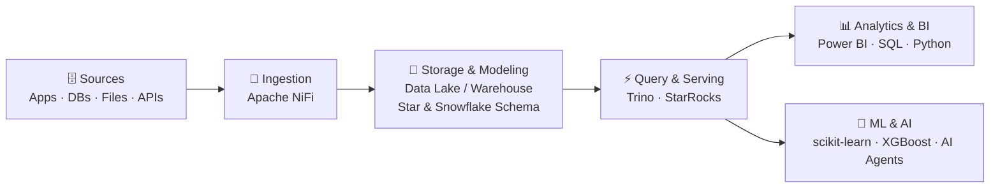

<h1 align="center">Hi, I'm Viet (Lê Hoàng Việt) 👋</h1>
<h3 align="center">Data & AI @ VinSmart Future · IT Student @ VNU-UET</h3>

  
  
  

---

## 🧭 About Me

I work in **Data & AI** at **VinSmart Future**, the technology company of Vingroup, while studying Information Technology as a third-year student at the **University of Engineering and Technology – VNU (VNU-UET)**. My focus spans **Data Analytics**, **Data Engineering**, and applied **AI**.

I think about data **end to end**: from the moment a record leaves its source system to the moment it shows up as a number someone makes a decision on. Day to day, that means getting hands-on across the layers of a **modern data platform**: ingesting data with **Apache NiFi**, modeling it into clean, analytics-ready structures, querying across sources with **Trino**, serving fast analytics with **StarRocks**, and turning the result into **dashboards, insights, and AI-powered products**.

- 💼 **Data & AI** @ **VinSmart Future** (Vingroup)
- 🎓 B.Sc. Information Technology, VNU-UET (2023 – present) · GPA **3.41 / 4.0**
- 🏅 **Microsoft Certified: Data Analyst Associate**
- 🥉 **Bronze Medal** – Kaggle Competition (2025)
- 🏗️ Building hands-on with the **NiFi → Trino → StarRocks** data platform stack
- 💬 Ask me about **data pipelines, SQL engines, data modeling, Power BI / DAX, and RFM segmentation**

---

## 🏗️ The Data Platform I Work Across

Every tool I use has a place in one flow, from raw data to decisions:

| Stage | What I do | Tools |
|---|---|---|
| **1. Ingestion** | Build data flows that collect, route, and transform data from many sources in near real time | Apache NiFi, Python |
| **2. Storage & Modeling** | Design ETL/ELT pipelines and dimensional models that keep data clean, consistent, and query-friendly | SQL, Star / Snowflake Schema, Data Warehouse |
| **3. Query & Serving** | Query across systems with a federated SQL engine; serve sub-second analytics with an MPP OLAP database | Trino, StarRocks |
| **4. Analytics & BI** | Explore data, build semantic models and dashboards that answer business questions | Power BI (DAX, Power Query), Excel, Pandas |
| **5. ML & AI** | Turn curated data into predictive models and safe, tool-gated AI assistants | scikit-learn, XGBoost, DeepAgent, Prompt Engineering |

---

## 🛠️ Tech Stack

**Languages**

**Data Engineering & Platform**

**Analytics & BI**

**Machine Learning & AI**

---

## 🚀 Featured Projects

### 🏥 MedTriage AI — Emergency Intake Assistant
An AI assistant that collects patient symptoms while they wait in the emergency department.
- Built on a **tool-gated DeepAgent** architecture with strictly limited permissions for safe operation.
- Auto-generates standardized **SBAR** handoff notes and suggests **ESI** triage levels, flagging critical warning signs instantly.
- Safety-first by design: the system **never diagnoses or prescribes**; it only supports doctors and nurses, who make the final call.

### 🛒 Retail Sales & Customer Analytics
An end-to-end **Power BI** dashboard for tracking retail revenue trends and customer behavior.
- **ETL with Power Query (M)** to connect, clean, and transform data from multiple scattered sources.
- **DAX measures & calculated columns** (`MAXX`, `LOOKUPVALUE`, `RELATED`, …) for multi-dimensional analysis.

### 👥 Customer 360 — RFM Segmentation
Customer segmentation based on transaction history using **Recency, Frequency, Monetary** analysis.
- Designed a **Star Schema** data model optimized for large-scale analytical queries.
- **Stack:** SQL · Power BI · Advanced DAX

### 📈 Data Analysis & Predictive Modeling — Kaggle (2025) 🥉
- Cleaned and processed large raw datasets with **Python (Pandas, NumPy)** and **SQL**.
- Ran **EDA** and visualizations to uncover hidden patterns and market trends.
- Built predictive models with **scikit-learn** and **XGBoost**, earning a **Bronze Medal**.

---

## 📊 GitHub Stats

  <picture>
    <source media="(prefers-color-scheme: dark)" srcset="https://github-profile-summary-cards.vercel.app/api/cards/profile-details?username=vietlhwork-arch&theme=github_dark"/>
    
  </picture>

  <picture>
    <source media="(prefers-color-scheme: dark)" srcset="https://streak-stats.demolab.com?user=vietlhwork-arch&theme=github-dark-blue&hide_border=true"/>
    
  </picture>

  <picture>
    <source media="(prefers-color-scheme: dark)" srcset="https://github-profile-summary-cards.vercel.app/api/cards/stats?username=vietlhwork-arch&theme=github_dark"/>
    
  </picture>
  <picture>
    <source media="(prefers-color-scheme: dark)" srcset="https://github-profile-summary-cards.vercel.app/api/cards/repos-per-language?username=vietlhwork-arch&theme=github_dark"/>
    
  </picture>

---

  <i>Always happy to talk about <b>data, analytics, and AI</b> — feel free to reach out!</i>

